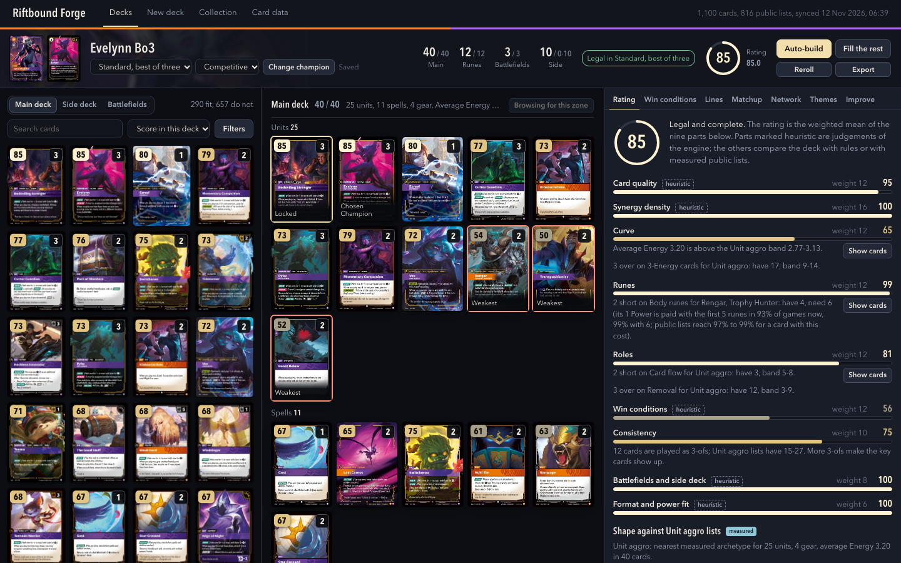
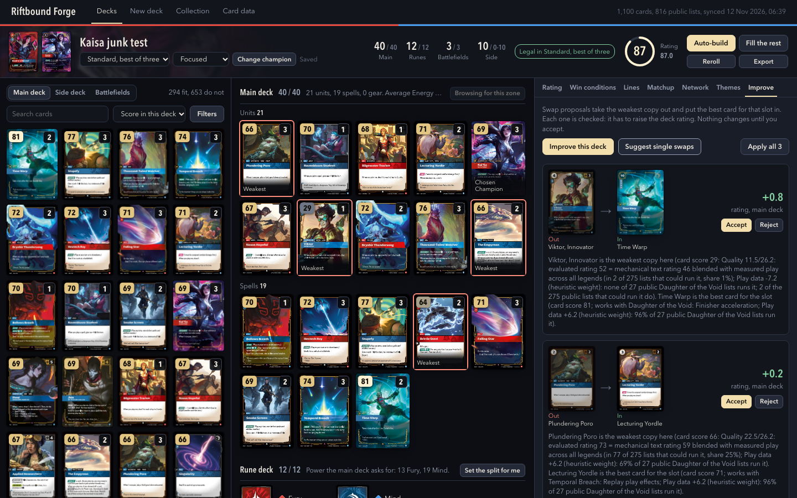
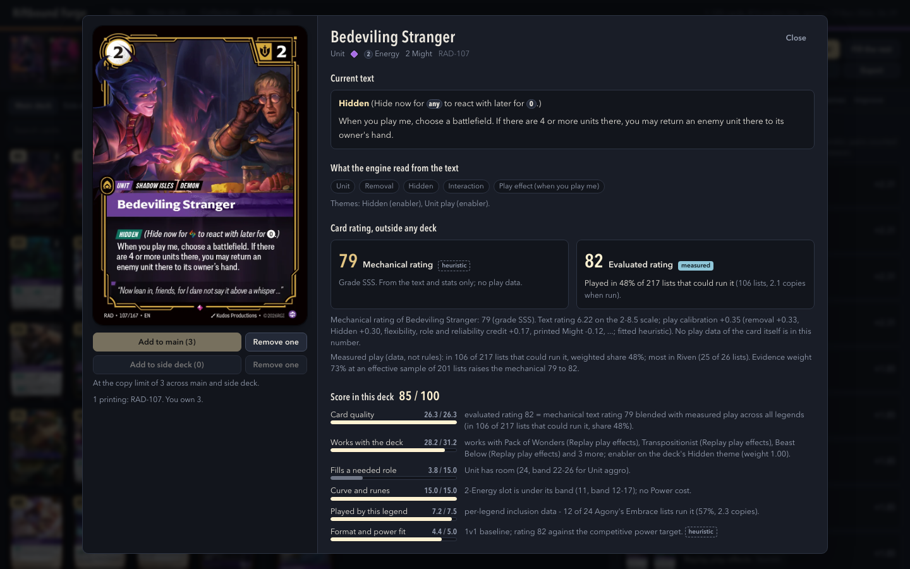
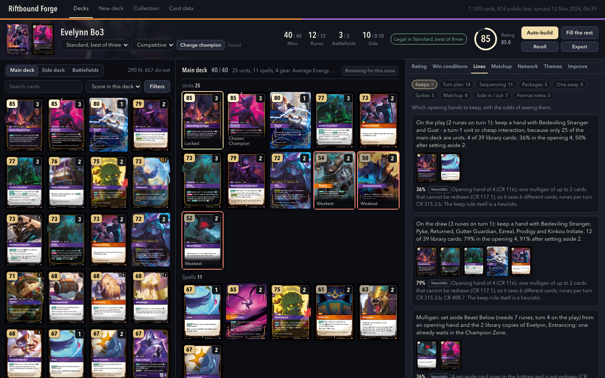
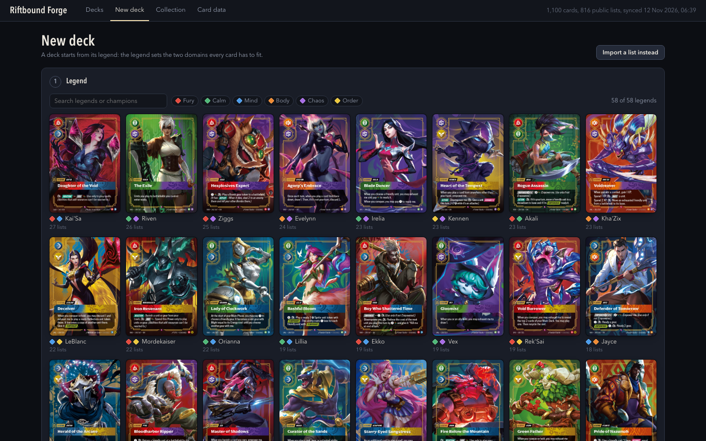
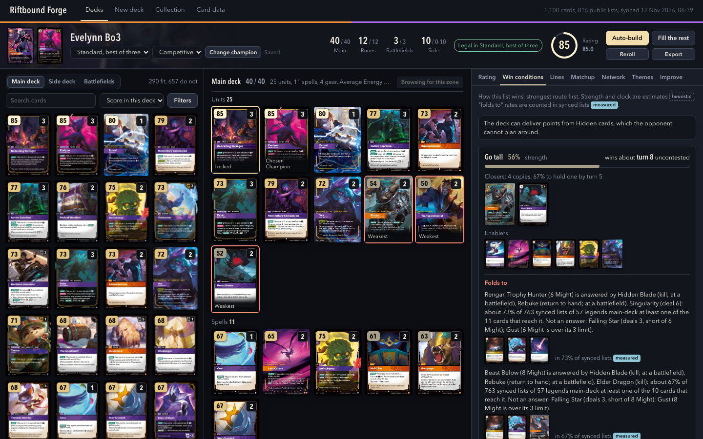
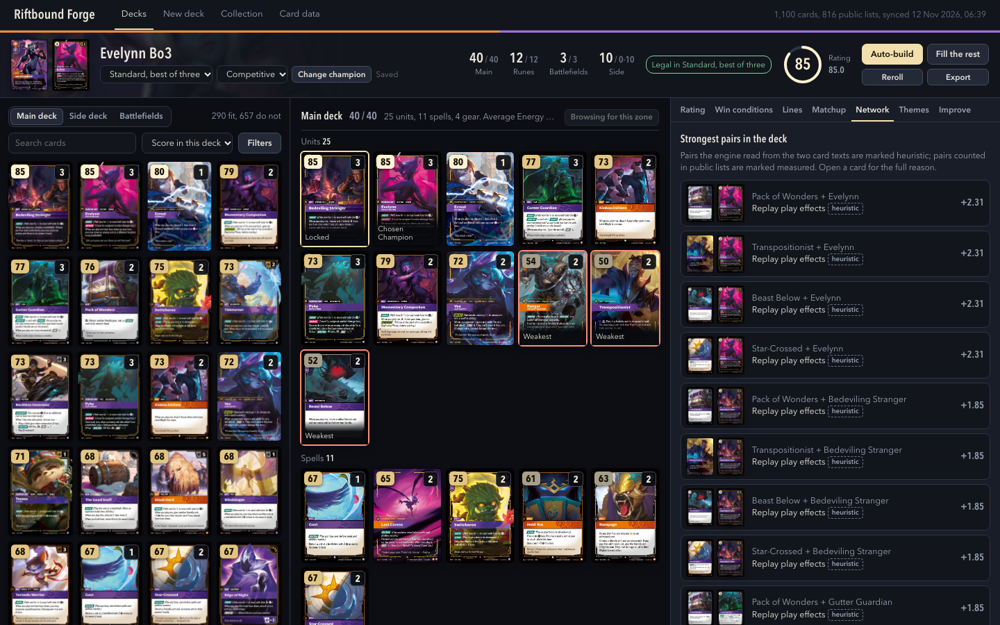

<div align="center">

# ⚒️ Riftbound Forge

### The open-source Riftbound TCG deck builder

**Build, rate and improve Riftbound decks on your own computer. Mac and Windows.**

[](https://github.com/Egecan33/riftbound-deck-builder/releases/latest)
[](https://github.com/Egecan33/riftbound-deck-builder/releases)
[](LICENSE)




</div>

Pick a Legend. Riftbound Forge builds a legal deck, tells you why each card is there, scores every other card against *your* Legend and deck, rates the whole list, and shows the lines your cards make: which cards work together, how the deck wins, what to keep in your opening hand and what to side in against a given opponent. Paste a list you already play and it proposes swaps one at a time, with the reason and the rating change.

It runs on your machine. Card data, about 1,100 card images and recent public deck lists are downloaded once; after that it works offline.

## What it does

- **Auto-build** a legal deck from a Legend and Chosen Champion: main deck, rune deck, battlefields and side deck, for best-of-one or best-of-three. Every pick comes with its reason. **Fill the rest** around cards you lock in.
- **Build by hand** in an image-first builder with live legality, scores and rating as you add and cut.
- **Card scores 0–100** for this Legend and this deck, each opening into its parts and plain-language reasons.
- **Deck rating 0–100** with sub-scores (curve, rune split, interaction, card flow, synergy, win conditions, consistency) and concrete fixes.
- **Improve a list.** Import a deck (text or deck code); get ordered swaps with the card going out, the card coming in, why, and the rating change. Accept or reject one at a time.
- **Lines.** Card interactions and packages, win routes with named closers, opening-hand keeps, a turn plan from your real curve, and matchup and side-deck notes against an opponent Legend.
- **Formats.** 1v1, 2v2 and free-for-all, each with its own deck rules.
- **Rules enforced exactly.** Deck construction follows the official Core and Tournament Rules, the ban list and set legality, with the rule named when a deck breaks one.
- **Collection** import, with an owned-only mode, and export of any deck as text.

<table>
<tr>
<td width="50%"><br><sub>Improve: swaps with reasons and rating change</sub></td>
<td width="50%"><br><sub>Every score explains itself</sub></td>
</tr>
<tr>
<td><br><sub>Lines: packages, keeps and matchups from your own cards</sub></td>
<td><br><sub>Pick from every legal Legend</sub></td>
</tr>
<tr>
<td><br><sub>How the deck wins, with named closers</sub></td>
<td><br><sub>The interaction network behind the lines</sub></td>
</tr>
</table>

## Download

No Node.js or anything else to install. Get the zip for your computer from the [latest release](https://github.com/Egecan33/riftbound-deck-builder/releases/latest):

| Computer | File |
|---|---|
| Mac with Apple Silicon (M1 and later) | `RiftboundForge-<version>-macos-arm64.zip` |
| Mac with Intel | `RiftboundForge-<version>-macos-x64.zip` |
| Windows 10/11 (x64) | `RiftboundForge-<version>-windows-x64.zip` |

Unzip it and double-click `Riftbound Forge.command` (macOS) or `Riftbound Forge.bat` (Windows). A terminal window opens and the app opens in your browser. Keep the window open while you use it; close it or press Ctrl+C to stop.

- **First run** downloads card data and recent public deck lists (about 3 minutes, then the app opens) and the card images in the background (about 110 MB, about 2 minutes). Cards show without pictures until theirs arrive.
- **macOS** may say the developer is unidentified (the app is not signed): right-click `Riftbound Forge.command`, choose **Open**, then **Open** again. Only needed once. Or run `xattr -dr com.apple.quarantine /path/to/the/folder` in Terminal.
- **Windows SmartScreen** may warn you (the app is not signed): click **More info**, then **Run anyway**.
- Your decks, settings, card data and images live in `~/Library/Application Support/Riftbound Forge` (macOS) or `%LOCALAPPDATA%\Riftbound Forge` (Windows). To update, download the new zip; your data is kept. Refresh card data and deck lists from the **Data** page.

The app listens on 127.0.0.1 only (port 3220, or the next free one up to 3229).

## Run from source

Requires Node 22+ and [pnpm](https://pnpm.io).

```bash
git clone https://github.com/Egecan33/riftbound-deck-builder.git
cd riftbound-deck-builder
pnpm install
pnpm sync all        # cards, errata, legality, meta lists, features, images into data/
pnpm build
pnpm start           # http://localhost:3220
```

`pnpm dev` runs the development server, `pnpm test` the unit tests, `pnpm e2e` the browser journeys (they need a synced database). `pnpm build && pnpm build:sync && pnpm package` assembles a portable zip for the computer it runs on, the same way the release workflow does.

## How it works

```
src/engine/    pure TypeScript, no IO: rules, features, network, evidence, scoring, rating, wincons, lines, builder
src/ingest/    the sync CLI: cards, errata, legality, meta lists, features, images into SQLite
src/server/    SQLite repositories, analysis cache and route handlers
src/app/       Next.js UI
sync-data/     reviewed snapshots: ban list and set legality, errata, per-card overrides
docs/research  verified research the engine is built on
```

1. **Cards and rules.** The card gallery is synced and corrected with reviewed errata and overrides. Legality (bans, set dates, copy limits) is a data file with sources, so a new set or ban is a re-sync.
2. **Features.** Each card's text is parsed into mechanics and roles (removal, card flow, tokens, buffs, and so on).
3. **Network.** Cards that work together are linked by mechanical reasons, then weighted by how often public lists play them together.
4. **Scores and rating.** A card's score combines its quality, its synergy with the deck and Legend, and its play rate in that Legend's lists; the rating combines the sub-scores. Both are recomputed on every change.
5. **Builder and Improve.** The builder starts from the Legend's core cards in public lists and climbs the rating; Improve searches single swaps that raise it.

### What is heuristic

Riftbound has no official power ranking and no public game-result database, so the scores, the rating, the win routes and the matchup notes are estimates from card text and public deck lists, not measured win rates. Specifically:

- The rating can rank some consensus tournament lists below decks the builder reaches; the builder therefore protects each Legend's core cards.
- Legends with very few public lists get generic builds.
- 2v2 and free-for-all use Standard lists as their play data.
- A fresh install fetches a limited number of recent lists on first sync; repeated syncs from the Data page add more.

## Roadmap

- [x] Research: deck rules for 1v1 / 2v2 / FFA, legality, meta sources, deck theory, mechanics, interactions, win conditions
- [x] Design document and implementation plan
- [x] Data sync: cards, images, legality, errata, public deck lists
- [x] Engine: rules, card features, interaction network, scoring, rating, builder, lines
- [x] API and UI
- [x] End-to-end tests
- [x] Downloads for macOS and Windows
- [ ] Signed builds
- [ ] Multiplayer deck lists for 2v2 and FFA

## Data sources

- Card data and images: the official Riftbound card gallery.
- Ban list, set legality and rules: the official Riftbound Rules Hub, reviewed into `sync-data/`.
- Public deck lists: Piltover Archive, fetched slowly and cached.

## Contributing

Issues and pull requests are welcome. If you work with a coding agent, point it at [`AGENTS.md`](AGENTS.md) first.

## Legal

Riftbound Forge is a fan project. It isn't endorsed by Riot Games and doesn't reflect the views or opinions of Riot Games or anyone officially involved in producing or managing Riot Games properties. Riot Games, Riftbound and all associated properties are trademarks or registered trademarks of Riot Games, Inc.

This repository and the downloads contain no card images or card data. The app downloads them to your machine for personal use; they remain the property of Riot Games. If you sync deck lists from community sites, respect each site's terms and keep requests slow.

Code is released under the [MIT License](LICENSE).
